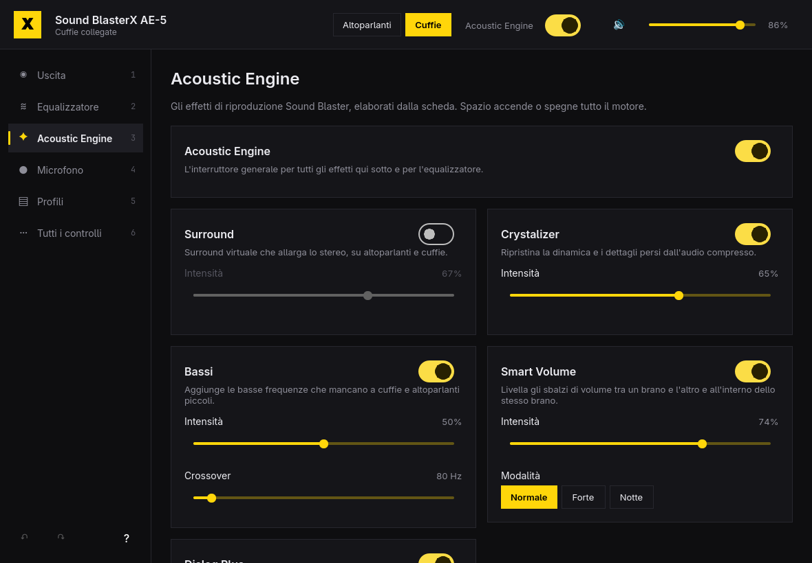

# BlasterX



A control panel for Creative Sound Blaster cards on the CA0132 codec (AE-5,
AE-5 Plus, AE-7, Z, ZxR, Recon3D) on Linux, in the spirit of Creative's
Windows-only Sound Blaster Command. It talks to the card's ALSA mixer
directly, so everything the `snd_hda_codec_ca0132` driver exposes is here:

- **Output**: speakers or headphones, automatic switching, headphone amplifier
  gain (16–600 Ω), the DAC's reconstruction filter, speaker layout up to 5.1,
  bass redirection, channel levels, and which jacks are connected.
- **Equalizer**: ten bands at ±24 dB and the card's presets.
- **Acoustic Engine**: Surround, Crystalizer, Bass, Smart Volume and Dialog
  Plus, each with its strength.
- **Microphone**: input source, boost, What U Hear, and CrystalVoice (Voice
  Focus with its angle, noise reduction, Smart Volume, voice morphing).
- **Profiles**: save every setting under a name and switch in one step.
- **All controls**: every driver control by its ALSA name.

Changes apply to the card as you make them, and changes made elsewhere
(`alsamixer`, scripts) show up in the window. The card keeps its settings
across reboots through `alsactl`, which Arch runs at boot.

## Install

On Arch Linux, install the package from the
[latest release](https://github.com/EdoardoMenicucci/blasterx/releases/latest):

```sh
sudo pacman -U https://github.com/EdoardoMenicucci/blasterx/releases/download/v0.1.0/blasterx-0.1.0-1-x86_64.pkg.tar.zst
```

To build it from source instead, see [Build](#build).

## Keyboard

| Key | Action |
| --- | --- |
| `1`–`6` | Go to a page |
| `Space` | Turn the Acoustic Engine on or off |
| `O` | Switch between speakers and headphones |
| `+` / `-` | Master volume up or down |
| `M` | Mute or unmute |
| `Ctrl+Z` / `Ctrl+Shift+Z` | Undo / redo |
| `Ctrl+S` | Save the settings as a profile |
| `?` | Show every shortcut |
| `Q` | Quit |

## Command line

The same controls and profiles work without a window, for scripts and
Hyprland key bindings. Every command exits 0 or 1, with errors on stderr,
and `--json` prints machine-readable output.

```sh
blasterx list                                  # every control and its value
blasterx get "AE-5: Headphone Gain" --json
blasterx set "Output Select" headphone         # on/off, a number, or a choice
blasterx set "FX: Crystalizer Playback Volume" 60
blasterx profile save Games
blasterx profile apply Music
```

Profiles are JSON files in `~/.config/blasterx/profiles/`. The card is found
by its Creative codec; set `BLASTERX_CARD=hw:2` to pick one explicitly.

## Build

```sh
bin/build     # build/blasterx
bin/test      # backend, theme and translation tests, offscreen
bin/install   # makepkg -fsi: installs the binary, launcher entry and icon
```

Needs Qt 6 (base, declarative, wayland) and alsa-lib. The window follows the
Omarchy theme accent, window rounding, and language (English and Italian).
